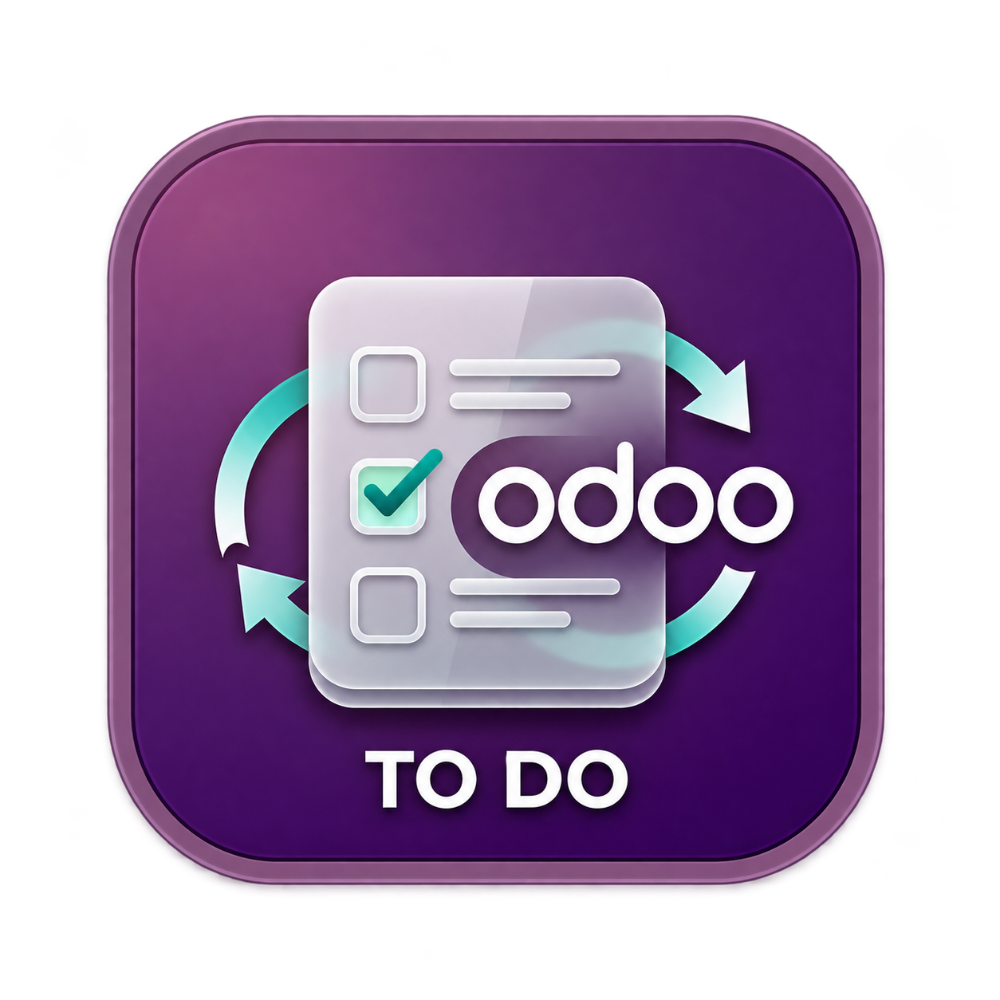

<div align="center">
  

  <h1>Odoo To Do</h1>
  <p><strong>Your Odoo tasks, in a focused macOS desktop app.</strong></p>
  <p>Multiple Odoo connections · Rich notes · Offline editing</p>

  <p>
    <a href="LICENSE"></a>
    
    
    
    
  </p>

  <p>
    <a href="#features">Features</a> ·
    <a href="#quick-start">Quick start</a> ·
    <a href="#connect-to-odoo">Connect to Odoo</a> ·
    <a href="#build-and-test">Build &amp; test</a> ·
    <a href="#synchronization">Synchronization</a>
  </p>
</div>

---

Odoo To Do brings the tasks assigned to you into a three-column workspace: connections and projects on the left, a task list in the middle, and a flexible notes panel on the right. Connect multiple Odoo instances, edit descriptions with images and formatting, and open any synchronized task in your browser.

## Features

| | What you can do |
| --- | --- |
| **Your assigned tasks** | See tasks whose `user_ids` includes the user connected to each instance. New tasks are automatically assigned to that user. |
| **Multiple connections** | Switch between Odoo instances, each with its own credentials and identifying color. |
| **Rich notes** | Edit HTML descriptions with bold, italic, underline, bulleted and numbered lists, links, undo, and redo. |
| **Images in context** | Paste images with **Cmd+V** or choose a file. Click an image to enlarge it, view its original size, or enter full screen when supported. |
| **Offline editing** | Store tasks and edits locally in SQLite. Pending changes are queued for synchronization when a connection is available. |
| **A focused workspace** | Search tasks, star important work, browse completed tasks, and give your notes more room as the window expands. |
| **Made for macOS** | Translucent panels, light and dark appearance, window dragging, and the app's name and icon in the Dock and Cmd+Tab. |

### Notes and images

The **Notes and description** editor saves automatically. Images are embedded in the description's HTML, stored locally, and sent to Odoo with the task's other pending changes.

Supported image formats: **PNG, JPEG, GIF, and WebP**. Each image can be up to **5 MB**, with a maximum of **10 MB per insertion**.

## Quick start

### Prerequisites

- macOS with Xcode Command Line Tools and the native build requirements for Tauri 2.
- Rust and Cargo.
- Node.js and pnpm.
- Python 3, used by the macOS development launcher.
- An Odoo instance with JSON-RPC access to projects and tasks. The task model must expose `state` and `user_ids`.

### Run the desktop app

```bash
git clone https://github.com/ogaponte/odoo-to-do.git
cd odoo-to-do
pnpm install
pnpm tauri dev
```

The development command starts Vite and the Rust backend with automatic reloads. On macOS, a Cargo runner launches the development binary inside `src-tauri/target/debug/dev-bundle/Odoo To Do.app`, keeping the correct name and icon in the Dock and Cmd+Tab.

> **Frontend preview:** `pnpm dev` starts only the web interface. Native commands, local data, and Odoo synchronization require `pnpm tauri dev`.

## Connect to Odoo

1. Click **+** next to **Odoo Instances**.
2. Enter a display name, server URL, database name, username, and API key or password.
3. Choose a color and click **Test Connection**.
4. Click **Connect and Sync** to load your projects and assigned tasks.

Use **Open in Odoo** in the task details to open the record in your default browser. Locally created tasks must synchronize before this button becomes available. Your browser may ask you to sign in to Odoo separately.

### Keyboard shortcuts

| Shortcut | Action |
| --- | --- |
| **Cmd+R** | Request a synchronization. |
| **Cmd+V** | Paste text, formatted HTML, or images into the notes editor. |
| **Esc** | Close the image viewer; otherwise, close the task details. |

## Synchronization

Synchronization runs:

- A few seconds after the app starts.
- After creating or changing a task locally.
- Automatically every **3 minutes**.
- When you click **Sync** or press **Cmd+R**.

Local changes are sent to Odoo before remote data is downloaded. Unsynchronized edits are protected during downloads. A manual request made during another synchronization waits for that run, then processes new changes.

The sidebar shows pending changes, the last successful download time, and synchronization errors. Failed changes remain in the queue for a later attempt.

Completed tasks are identified by `state = 1_done`. They are hidden from the usual task list and remain available in **Completed**.

## Build and test

Run these commands from the repository root:

| Command | Purpose |
| --- | --- |
| `pnpm tauri dev` | Run the desktop app with automatic reloads. |
| `pnpm dev` | Preview the frontend only. |
| `pnpm build` | Check TypeScript and build the frontend. |
| `pnpm build:app` | Build a debug macOS `.app` bundle. |
| `pnpm tauri build` | Build release bundles. |
| `cargo test --manifest-path src-tauri/Cargo.toml --lib` | Run backend tests. |

### macOS build output

| Build | Application |
| --- | --- |
| Debug | `src-tauri/target/debug/bundle/macos/Odoo To Do.app` |
| Release | `src-tauri/target/release/bundle/macos/Odoo To Do.app` |

<details>
<summary><strong>Regenerate native app icons</strong></summary>

The interface uses [`public/logo.png`](public/logo.png). Regenerate the native icon sizes from that image with:

```bash
pnpm tauri icon public/logo.png --output src-tauri/icons
```

The generated macOS icon is `src-tauri/icons/icon.icns`.

</details>

## Under the hood

| Layer | Technology |
| --- | --- |
| Desktop shell | Tauri 2 |
| Frontend | React 19, TypeScript, Vite, Tailwind CSS 4 |
| Backend | Rust, Tokio, reqwest |
| Local storage | SQLite through rusqlite |
| Odoo connection | JSON-RPC |
| HTML sanitization | DOMPurify |

<details>
<summary><strong>Project structure</strong></summary>

```text
odoo-to-do/
├── public/logo.png                 # App branding
├── src/
│   ├── components/                 # Navigation, tasks, HTML editor, image viewer
│   ├── utils/                      # Window interactions and image insertion
│   ├── api.ts                      # Tauri IPC client
│   ├── App.tsx                     # Application state and layout
│   └── App.css                     # Typography and visual styles
└── src-tauri/
    ├── .cargo/config.toml          # macOS development runner
    ├── scripts/macos-dev-runner.py # Named development app bundle
    ├── icons/                      # Native app icons
    ├── src/                        # Database, Odoo client, synchronization
    ├── Info.plist                  # macOS display name and language
    └── tauri.conf.json             # Window and bundle configuration
```

</details>

## Local data

Application identifier: `com.odootodo.desktop`.

On macOS, local data is stored at:

```text
~/Library/Application Support/com.odootodo.desktop/odoo_tasks.db
```

The database contains connection settings, including API credentials, cached tasks, and queued changes. Local databases and their SQLite companion files are excluded by [`.gitignore`](.gitignore).

## Author

Created and maintained by **[Oscar Aponte](https://github.com/ogaponte)**.

## License

Odoo To Do is open-source software released under the [MIT License](LICENSE).

Copyright © 2026 Oscar Aponte.
